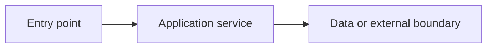
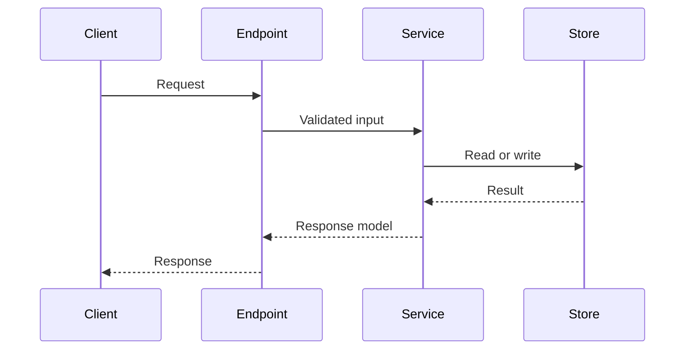
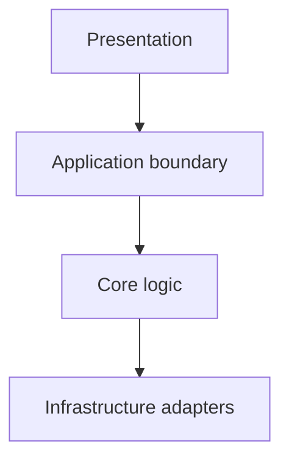

# Diagram patterns

Use diagrams only when they materially clarify relationships. Labels must describe verified components and edges.

## Component flow

## Request sequence

## Module dependencies

Do not put secrets, personal data, inferred network addresses, or repository-external paths in diagrams. Mark uncertain edges in accompanying prose instead of presenting them as fact.
