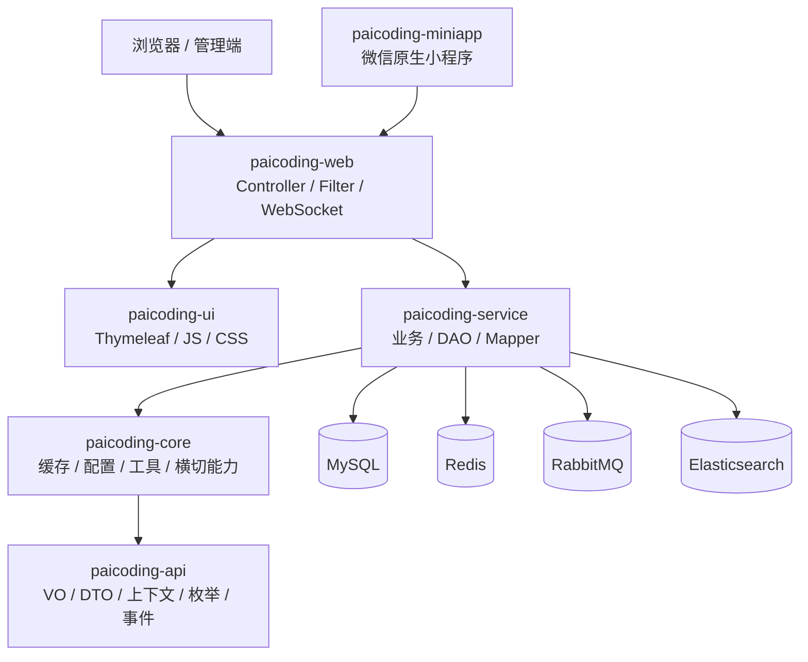

# 整体架构与模块

## TL;DR

**已验证**：根工程是 Maven 聚合项目，五个模块的依赖主干是 `web → service → core → api`，同时 `web → ui`。`paicoding-miniapp` 是仓库内独立客户端，不在根 POM 的 `<modules>` 中。`pom.xml:L5-L16` `paicoding-web/pom.xml:L22-L31` `paicoding-service/pom.xml:L14-L18` `paicoding-core/pom.xml:L19-L23`



## Maven 模块

| 模块 | 已验证职责 | 关键证据 |
|---|---|---|
| `paicoding-api` | 跨层数据契约：请求上下文、VO/DTO、枚举、事件、异常与部分公共实体。它只声明少量编译/provided 依赖，是依赖链底部。 | `paicoding-api/pom.xml:L10-L45`；`paicoding-api/src/main/java/com/github/paicoding/forum/api/model/context/ReqInfoContext.java:L16-L35`；`paicoding-api/src/main/java/com/github/paicoding/forum/api/model/vo/ResVo.java:L14-L44` |
| `paicoding-core` | 横切基础设施与通用能力：Redis 门面、动态数据源、异步、MDC、权限注解、网络/地区、敏感词、WebSocket 工具等；通过自动配置扫描整个 core 包。 | `paicoding-core/pom.xml:L10-L35`；`paicoding-core/src/main/java/com/github/paicoding/forum/core/ForumCoreAutoConfig.java:L23-L31` |
| `paicoding-service` | 领域业务和基础设施适配：article、comment、user、notify、statistics、rank、search、pay、image、AI 等；实体、DAO、MyBatis Mapper 也实际位于此模块。 | `paicoding-service/pom.xml:L10-L40`；`paicoding-service/src/main/java/com/github/paicoding/forum/service/ServiceAutoConfig.java:L11-L24` |
| `paicoding-ui` | Thymeleaf SSR 页面、组件、JavaScript、CSS 和前端第三方静态资源；以 Thymeleaf starter 作为唯一直接依赖。 | `paicoding-ui/pom.xml:L10-L19`；`paicoding-ui/src/main/resources/templates/views/home/index.html:L1-L20` |
| `paicoding-web` | 可执行应用与传输层：启动类、Controller、Servlet Filter、MVC 拦截器、全局异常处理、WebSocket、小程序 API 和环境配置；依赖 UI 与 Service。 | `paicoding-web/pom.xml:L10-L42`；`paicoding-web/src/main/java/com/github/paicoding/forum/web/QuickForumApplication.java:L41-L47` |

### 独立客户端：`paicoding-miniapp`

**已验证**：它不在 Maven reactor 中，是微信原生小程序。客户端通过 `/mini/api/**` 调用后端，覆盖登录、文章流、搜索、详情、评论、点赞、收藏、关注和个人中心；其清单还声明文章搜索 AI Skill。`paicoding-miniapp/README.md:L1-L7` `paicoding-miniapp/README.md:L24-L30` `paicoding-miniapp/utils/auth.js:L37-L50` `paicoding-miniapp/pages/index/index.js:L46-L71`

## 包结构：代码真正按什么分层

业务通常不是简单三层，而是：

```text
web/<场景>/...Controller
  → service/<领域>/service/<接口>
  → service/<领域>/service/impl/<实现>
  → service/<领域>/repository/dao/<聚合 DB 操作>
  → service/<领域>/repository/mapper/<MyBatis Mapper>
  → service/<领域>/repository/entity/<DO>
  → MySQL
```

DAO 层是项目的重要约定：它把 MyBatis-Plus 的单表 CRUD 和 XML/Mapper 的复杂查询封装起来，避免 Service 直接拼接所有持久化细节。文章 DAO 对自身职责的注释也明确写着“多表结构的操作封装，只与 DB 操作相关”。`paicoding-service/src/main/java/com/github/paicoding/forum/service/article/repository/dao/ArticleDao.java:L45-L60`

## 自动配置如何跨模块生效

`paicoding-core` 与 `paicoding-service` 都通过 `META-INF/spring.factories` 注册 Spring Boot 2.x 自动配置：

- Core 自动配置组件扫描 `com.github.paicoding.forum.core`，注册 `RedisClient` 使用的模板，并提供 Caffeine `CacheManager`。`paicoding-core/src/main/resources/META-INF/spring.factories:L1-L3` `paicoding-core/src/main/java/com/github/paicoding/forum/core/ForumCoreAutoConfig.java:L23-L50`
- Service 自动配置组件扫描整个 service 包，同时明确扫描九组 MyBatis Mapper 包。`paicoding-service/src/main/resources/META-INF/spring.factories:L1-L3` `paicoding-service/src/main/java/com/github/paicoding/forum/service/ServiceAutoConfig.java:L11-L23`
- Web 的 `@SpringBootApplication` 位于 `com.github.paicoding.forum.web`，负责 web 包本身的常规扫描；依赖模块靠上述自动配置加入容器。`paicoding-web/src/main/java/com/github/paicoding/forum/web/QuickForumApplication.java:L41-L47`

## 技术栈边界

| 能力 | 实现位置 |
|---|---|
| Web/SSR | Spring MVC + Thymeleaf；Web 模块依赖 starter-web，UI 模块依赖 starter-thymeleaf。`paicoding-web/pom.xml:L33-L42` `paicoding-ui/pom.xml:L14-L18` |
| ORM/数据库 | MyBatis-Plus + MySQL 驱动，实体/DAO/Mapper 在 service。`paicoding-service/pom.xml:L33-L40` |
| 缓存与会话 | Spring Data Redis 经 `RedisClient` 封装；另有本地 Caffeine。`paicoding-core/src/main/java/com/github/paicoding/forum/core/ForumCoreAutoConfig.java:L30-L50` |
| 消息 | Spring AMQP/RabbitMQ，使用 Outbox、发布确认、重试、死信队列和幂等消费。`paicoding-service/src/main/java/com/github/paicoding/forum/service/notify/config/RabbitMqAutoConfig.java:L27-L41` |
| 搜索 | Elasticsearch 7.x High Level Client，业务层内部使用其 low-level client 发 REST 请求。`paicoding-service/pom.xml:L70-L86` `paicoding-service/src/main/java/com/github/paicoding/forum/service/article/service/search/impl/ArticleSearchServiceImpl.java:L1926-L1929` |
| 认证 | 用户名密码/微信/知识星球/小程序等入口，统一生成 JWT，并以 Redis 保存 token 有效态。`paicoding-service/src/main/java/com/github/paicoding/forum/service/user/service/LoginService.java:L16-L65` |

## 已观察到的架构特点

- **模块分层与领域分包并存**：模块解决依赖边界，`service` 内的 article/user/comment 等包解决业务边界。
- **同步主事务 + 异步副作用**：核心写入落 MySQL；Outbox 在同事务记录事件，定时发布到 RabbitMQ，再由通知、统计、排行、搜索消费者各自处理。
- **可降级基础设施**：RabbitMQ 和 Elasticsearch 都有配置开关；ES 不可用时，文章搜索明确回退到 MySQL 标题搜索。
- **请求上下文贯穿各层**：Filter 构造 `ReqInfoContext`，Controller/Service 从中读取当前用户、会话、IP、设备等信息。

## 文档与源码的差异

仓库 `AGENTS.md` 把“Entity classes in paicoding-api”作为指导。`AGENTS.md:L65-L69` 但当前业务 DO（如 `ArticleDO`、`UserDO`）实际在 `paicoding-service/.../repository/entity`。`paicoding-service/src/main/java/com/github/paicoding/forum/service/article/repository/entity/ArticleDO.java:L18-L20` `paicoding-service/src/main/java/com/github/paicoding/forum/service/user/repository/entity/UserDO.java:L16-L19` 因此本文以当前源码为准：API 主要是跨层模型，持久化 DO 主要在 Service。

[返回索引](README.md) · [下一页：启动与请求生命周期](02-startup-and-request-lifecycle.md)

