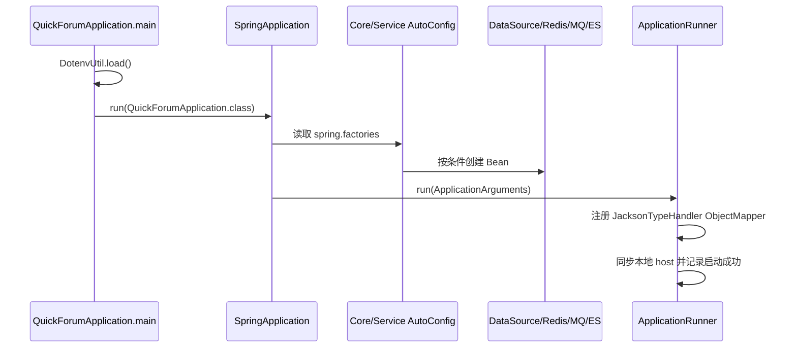
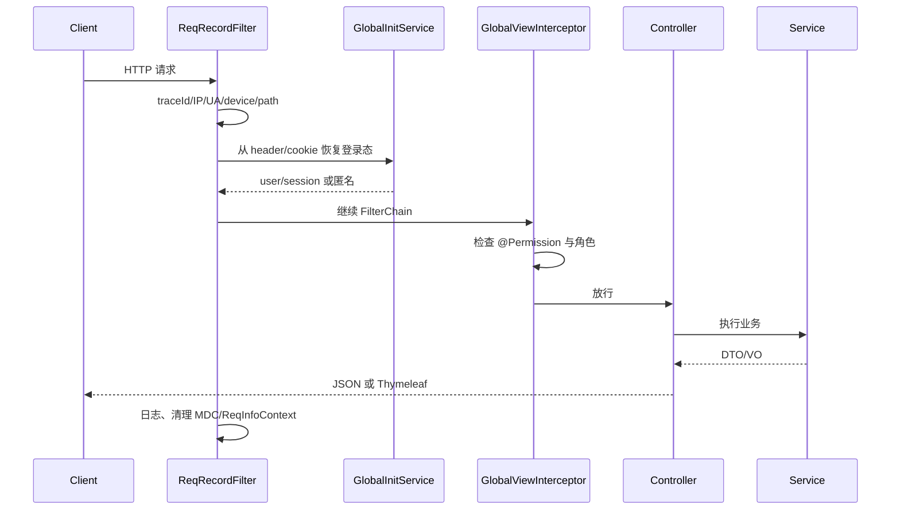

# Spring Boot 启动与请求生命周期

## TL;DR

**已验证**：`QuickForumApplication.main` 先加载 dotenv，再调用 `SpringApplication.run`。启动类同时开启异步、定时任务、Spring Cache 和 Servlet 组件扫描；Core/Service 则由各自的 `spring.factories` 自动配置进入容器。应用就绪后，`ApplicationRunner` 设置 MyBatis JSON 类型处理器并同步本地访问地址。`paicoding-web/src/main/java/com/github/paicoding/forum/web/QuickForumApplication.java:L41-L46` `paicoding-web/src/main/java/com/github/paicoding/forum/web/QuickForumApplication.java:L83-L86` `paicoding-web/src/main/java/com/github/paicoding/forum/web/QuickForumApplication.java:L110-L117`

## 启动序列

### 1. Java 主入口

- `@EnableAsync`：允许 Service 中的 `@Async` 搜索同步等异步方法。
- `@EnableScheduling`：允许 Outbox 发布器、搜索一致性检查、排行汇总等定时任务。
- `@EnableCaching`：启用注解缓存；项目显式提供 Caffeine 管理器。
- `@ServletComponentScan`：发现 `ReqRecordFilter` 等 Servlet 组件。
- `@SpringBootApplication`：启用 Web 模块的自动配置与组件扫描。

这些注解集中在启动类。`paicoding-web/src/main/java/com/github/paicoding/forum/web/QuickForumApplication.java:L41-L47`

### 2. 跨模块自动配置

Spring Boot 2.7 会读取依赖 JAR 中的 `META-INF/spring.factories`。Core 注册 `ForumCoreAutoConfig`，Service 注册 `ServiceAutoConfig`。前者扫描 core 包并将 `RedisTemplate` 注册到静态门面；后者扫描 service 包并执行 Mapper 扫描。`paicoding-core/src/main/resources/META-INF/spring.factories:L1-L3` `paicoding-service/src/main/resources/META-INF/spring.factories:L1-L3` `paicoding-service/src/main/java/com/github/paicoding/forum/service/ServiceAutoConfig.java:L11-L23`

### 3. 条件化基础设施

- 动态数据源只在 `spring.dynamic.primary` 存在时启用；否则 Spring Boot 的普通数据源自动配置可接管。`paicoding-core/src/main/java/com/github/paicoding/forum/core/dal/DataSourceConfig.java:L29-L33`
- RabbitMQ Bean、Outbox Publisher 和消费者只在 `rabbitmq.switchFlag=true` 时启用。`paicoding-service/src/main/java/com/github/paicoding/forum/service/notify/config/RabbitMqAutoConfig.java:L27-L29` `paicoding-service/src/main/java/com/github/paicoding/forum/service/notify/service/impl/DomainEventOutboxPublisher.java:L19-L22`
- Elasticsearch Client 只在 `elasticsearch.open` 条件满足时创建。`paicoding-service/src/main/java/com/github/paicoding/forum/service/config/es/ElasticsearchConfig.java:L32-L38`

### 4. 数据库初始化

`ForumDataSourceInitializer` 创建 `DataSourceInitializer`，判断是否需要首次初始化；Liquibase 开启时由变更日志管理结构，未开启时才回退到资源脚本。它还包含数据库不存在时尝试创建 MySQL schema 的逻辑。`paicoding-web/src/main/java/com/github/paicoding/forum/web/config/init/ForumDataSourceInitializer.java:L47-L68` `paicoding-web/src/main/java/com/github/paicoding/forum/web/config/init/ForumDataSourceInitializer.java:L77-L101` `paicoding-web/src/main/java/com/github/paicoding/forum/web/config/init/ForumDataSourceInitializer.java:L105-L140`

> 这是启动代码的静态行为，不代表当前环境一定会创建数据库；本次没有连接数据库或执行迁移。

## 一次 HTTP 请求的生命周期

### Filter：建立请求上下文

`ReqRecordFilter` 在进入业务前创建 traceId，采集 host/path/referer/clientIp/User-Agent/deviceId，然后调用 `GlobalInitService.initLoginUser`，最后把完整 `ReqInfo` 放进线程上下文。请求结束时无论成功失败都会清理 MDC 与 `ReqInfoContext`。`paicoding-web/src/main/java/com/github/paicoding/forum/web/hook/filter/ReqRecordFilter.java:L90-L112` `paicoding-web/src/main/java/com/github/paicoding/forum/web/hook/filter/ReqRecordFilter.java:L125-L179`

### 登录态恢复

普通 Web 请求从名为 `f-session` 的 Cookie 取 token；小程序 `/mini/api/**` 还允许 Bearer、`f-session` 或 `X-Pai-Token` 请求头。恢复成功后填充当前用户、userId、session 和未读消息数。`paicoding-web/src/main/java/com/github/paicoding/forum/web/global/GlobalInitService.java:L113-L137` `paicoding-web/src/main/java/com/github/paicoding/forum/web/global/GlobalInitService.java:L139-L170`

### Interceptor：权限与视图全局属性

启动类把 `GlobalViewInterceptor` 注册到 `/**`。`paicoding-web/src/main/java/com/github/paicoding/forum/web/QuickForumApplication.java:L63-L66` 拦截器读取方法或类上的 `@Permission`：匿名访问受保护 REST 接口时返回统一错误；页面请求重定向；登录后再按角色判断。`paicoding-web/src/main/java/com/github/paicoding/forum/web/hook/interceptor/GlobalViewInterceptor.java:L49-L95` 对 MVC 视图，它还注入全局站点、用户、统计与 SEO 属性。`paicoding-web/src/main/java/com/github/paicoding/forum/web/hook/interceptor/GlobalViewInterceptor.java:L98-L114`

## 启动后的 Runner

`ApplicationRunner.run` 做两件事：

1. 为 MyBatis-Plus `JacksonTypeHandler` 设置 `ObjectMapper`，支持 varchar/json 与实体 JSON 字段转换。
2. 在本地开发场景同步实际端口到站点 host。

证据：`paicoding-web/src/main/java/com/github/paicoding/forum/web/QuickForumApplication.java:L110-L129`。

## 待调查

- 各 profile 下哪些外部服务实际开启，必须读取部署环境变量并运行健康检查后才能确认；本文没有读取秘密值。
- 初始化器、Liquibase 与外部数据库权限之间的真实执行顺序需在隔离开发环境验证。
- 启动类会调用 `DotenvUtil.load()`，但本次按安全要求没有读取仓库 `.env`。

[上一页：架构](01-architecture-and-modules.md) · [返回索引](README.md) · [下一页：数据库调用链](03-controller-service-mapper-database.md)

