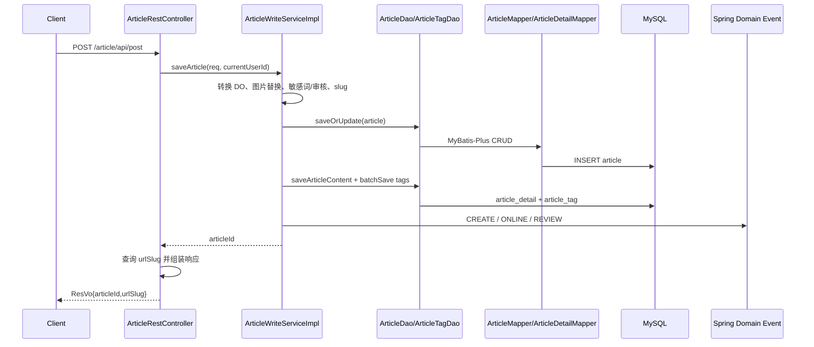
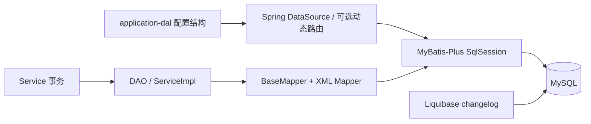

# Controller → Service → DAO/Mapper → 数据库

## TL;DR

项目常见调用链不是直接的三层，而是 `Controller → Service 接口 → ServiceImpl → DAO → Mapper → MySQL`。DAO 往往继承 MyBatis-Plus `ServiceImpl<Mapper, DO>`，简单 CRUD 走 `baseMapper`/lambda API，复杂查询落在 Mapper 接口和 XML。文章发布是最完整的代表：一个事务内写文章、正文、标签和阅读足迹，再记录领域事件。`paicoding-service/src/main/java/com/github/paicoding/forum/service/article/repository/dao/ArticleDao.java:L45-L71` `paicoding-service/src/main/java/com/github/paicoding/forum/service/article/repository/mapper/ArticleMapper.java:L16-L31`

## 代表链路：发布文章

### 1. Controller：传输层与权限边界

`POST /article/api/post` 带 `@Permission(LOGIN)`，从 `ReqInfoContext` 取当前 userId，调用写服务；完成后查询文章 slug，返回跳转所需字段。`paicoding-web/src/main/java/com/github/paicoding/forum/web/front/article/rest/ArticleRestController.java:L197-L221`

Controller 的职责主要是：

- 路由与参数绑定；
- 权限注解；
- 从请求上下文取身份；
- 调用 Service；
- 组装 `ResVo`、页面 VO 或模板片段。

### 2. Service 接口与实现：业务事务

接口只暴露保存/更新与删除。`paicoding-service/src/main/java/com/github/paicoding/forum/service/article/service/ArticleWriteService.java:L5-L22` 实现先做 DTO→DO、slug、图片引用和内容审核，然后用 `TransactionTemplate` 把新增/更新和专栏关联包在同一事务。`paicoding-service/src/main/java/com/github/paicoding/forum/service/article/service/impl/ArticleWriteServiceImpl.java:L85-L117`

新增文章时依次：

1. 根据白名单/审核规则设置状态；
2. 生成分布式 ID 并保存 `article`；
3. 保存 `article_detail` 正文；
4. 批量保存 `article_tag`；
5. 保存作者自己的阅读足迹；
6. 发布 CREATE，以及 ONLINE 或 REVIEW 事件。

源码证据：`paicoding-service/src/main/java/com/github/paicoding/forum/service/article/service/impl/ArticleWriteServiceImpl.java:L186-L217`。

### 3. DAO：持久化语义封装

`ArticleDao extends ServiceImpl<ArticleMapper, ArticleDO>`，因此继承 MyBatis-Plus CRUD；它又注入 `ArticleDetailMapper`、`ReadCountMapper`、`ArticleMapper` 处理文章聚合相关数据。`paicoding-service/src/main/java/com/github/paicoding/forum/service/article/repository/dao/ArticleDao.java:L45-L60`

例如读取详情先由 `baseMapper.selectById` 查文章，再由 Detail Mapper 取正文，并在审核中按身份控制正文展示。`paicoding-service/src/main/java/com/github/paicoding/forum/service/article/repository/dao/ArticleDao.java:L63-L85` 保存正文则构造 `ArticleDetailDO` 并调用 Mapper；更新正文按是否审核决定覆盖最后版本或插入新版本。`paicoding-service/src/main/java/com/github/paicoding/forum/service/article/repository/dao/ArticleDao.java:L145-L166`

### 4. Mapper：简单 CRUD 与复杂 SQL 的分界

`ArticleMapper extends BaseMapper<ArticleDO>`，单表 CRUD 无需 XML；热门文章、分类标签组合、后台筛选、搜索索引文档等复杂查询在接口声明，并由 `ArticleMapper.xml` 实现。`paicoding-service/src/main/java/com/github/paicoding/forum/service/article/repository/mapper/ArticleMapper.java:L22-L94` `paicoding-service/src/main/resources/mapper/ArticleMapper.xml:L189-L236`

## 数据库访问总流程

- 普通数据源由 Spring Boot 配置；若存在 `spring.dynamic.primary`，`DataSourceConfig` 创建多个 DataSource，并把选定主库设为 `AbstractRoutingDataSource` 默认目标。`paicoding-core/src/main/java/com/github/paicoding/forum/core/dal/DataSourceConfig.java:L29-L82`
- Mapper 包由 `ServiceAutoConfig.@MapperScan` 明确注册。`paicoding-service/src/main/java/com/github/paicoding/forum/service/ServiceAutoConfig.java:L11-L23`
- 事务既有 `@Transactional`，也有需要返回值/显式回调的 `TransactionTemplate`。文章删除使用注解事务，文章保存使用模板事务。`paicoding-service/src/main/java/com/github/paicoding/forum/service/article/service/impl/ArticleWriteServiceImpl.java:L91-L117` `paicoding-service/src/main/java/com/github/paicoding/forum/service/article/service/impl/ArticleWriteServiceImpl.java:L263-L278`
- 结构演进由 `paicoding-web/src/main/resources/liquibase/master.xml` 聚合；首次启动逻辑与 Liquibase 开关由初始化器协调。`paicoding-web/src/main/java/com/github/paicoding/forum/web/config/init/ForumDataSourceInitializer.java:L41-L68`

## 实体与表映射

持久化 DO 在 service 的各领域 `repository/entity` 下，以 `@TableName` 显式映射。例如文章、正文、标签、用户、足迹分别映射 `article`、`article_detail`、`article_tag`、`user`、`user_foot`。`paicoding-service/src/main/java/com/github/paicoding/forum/service/article/repository/entity/ArticleDO.java:L18-L20` `paicoding-service/src/main/java/com/github/paicoding/forum/service/article/repository/entity/ArticleDetailDO.java:L16-L19` `paicoding-service/src/main/java/com/github/paicoding/forum/service/user/repository/entity/UserFootDO.java:L14-L17`

## 新增数据库功能的落点

1. 表结构：在 Liquibase 中新增 changeset，不改历史已发布脚本。
2. DO：放对应领域的 `repository/entity`。
3. Mapper：简单 CRUD 继承 `BaseMapper`；复杂 SQL 增加 Mapper 方法和同名 XML statement。
4. DAO：封装持久化语义与多表读取，不把 SQL 细节泄漏给 Controller。
5. Service：处理业务规则、事务、领域事件。
6. Controller：只处理传输协议、身份与响应。

## 风险与待调查

- `ForumDataSourceInitializer` 含自动建库和兼容性修订逻辑，属于高权限启动行为；生产环境应单独审计数据库账号权限。`paicoding-web/src/main/java/com/github/paicoding/forum/web/config/init/ForumDataSourceInitializer.java:L105-L140`
- `DataSourceConfig` 中存在 Druid 监控 Servlet 的固定初始化参数；本文不复述敏感细节，部署前应审计并限制管理端点。`paicoding-core/src/main/java/com/github/paicoding/forum/core/dal/DataSourceConfig.java:L107-L121`
- 代码注释明确指出点赞/收藏足迹更新没有并发控制，当前接受最终误差风险。`paicoding-service/src/main/java/com/github/paicoding/forum/service/user/service/userfoot/UserFootServiceImpl.java:L81-L87`

[上一页：启动](02-startup-and-request-lifecycle.md) · [返回索引](README.md) · [下一页：Redis](04-redis.md)

