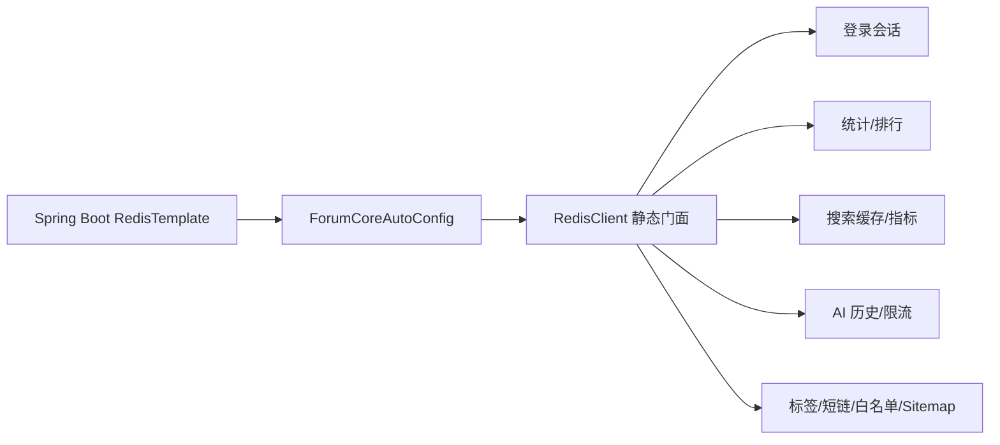

# Redis 使用地图

## TL;DR

Redis 不是单一“缓存层”，而是项目的会话有效态、计数器、排行榜、搜索缓存/指标、AI 限流与聊天历史、白名单、短链和站点地图等共享状态存储。Core 提供静态 `RedisClient` 门面并统一 key 前缀；Service 按领域调用。另有独立的 Caffeine 本地缓存，不应与 Redis 混淆。`paicoding-core/src/main/java/com/github/paicoding/forum/core/ForumCoreAutoConfig.java:L30-L50` `paicoding-core/src/main/java/com/github/paicoding/forum/core/cache/RedisClient.java:L31-L72`

## 初始化与访问方式

`ForumCoreAutoConfig` 构造时调用 `RedisClient.register(redisTemplate)`。`paicoding-core/src/main/java/com/github/paicoding/forum/core/ForumCoreAutoConfig.java:L27-L32` `RedisClient` 直接基于 RedisConnection 实现 string、hash、set、sorted set、list、HyperLogLog、Lua 和 pipeline 操作，并统一序列化。`paicoding-core/src/main/java/com/github/paicoding/forum/core/cache/RedisClient.java:L126-L174` `paicoding-core/src/main/java/com/github/paicoding/forum/core/cache/RedisClient.java:L177-L250` `paicoding-core/src/main/java/com/github/paicoding/forum/core/cache/RedisClient.java:L348-L415`

## 主要使用位置

| 场景 | 数据结构/作用 | 证据 |
|---|---|---|
| JWT 会话有效态 | token→userId 字符串、session 元数据字符串、user→sessions Set；支持登出、踢下线和设备限制 | `paicoding-service/src/main/java/com/github/paicoding/forum/service/user/service/help/UserSessionHelper.java:L137-L167` `paicoding-service/src/main/java/com/github/paicoding/forum/service/user/service/help/UserSessionHelper.java:L188-L216` |
| 文章/用户统计 | Hash 字段累加阅读、点赞、收藏、评论、粉丝等；MQ 统计消费者也更新这些 Hash | `paicoding-service/src/main/java/com/github/paicoding/forum/service/statistics/listener/StatisticDomainEventConsumer.java:L30-L56` |
| 活跃度排行榜 | Sorted Set 保存分数、Hash 保存并列时间，Lua 原子应用分数与月度汇总 | `paicoding-service/src/main/java/com/github/paicoding/forum/service/rank/service/impl/UserActivityRankServiceImpl.java:L208-L268` `paicoding-service/src/main/java/com/github/paicoding/forum/service/rank/service/impl/UserActivityRankServiceImpl.java:L327-L359` |
| Elasticsearch 搜索 | 首屏结果缓存、分页 cursor、查询/点击计数、热词/零结果词、重建锁与索引 generation | `paicoding-service/src/main/java/com/github/paicoding/forum/service/article/service/search/impl/ArticleSearchServiceImpl.java:L641-L665` `paicoding-service/src/main/java/com/github/paicoding/forum/service/article/service/search/impl/ArticleSearchServiceImpl.java:L1209-L1261` |
| AI 聊天 | Hash 保存会话目录、List 保存对话项并裁剪长度；Hash 计数做每日调用限流 | `paicoding-service/src/main/java/com/github/paicoding/forum/service/chatai/service/history/ChatHistoryServiceImpl.java:L48-L107` `paicoding-service/src/main/java/com/github/paicoding/forum/service/chatai/service/AbsChatService.java:L66-L86` |
| 标签缓存 | 按 tagId 缓存标签，写操作主动删除 | `paicoding-service/src/main/java/com/github/paicoding/forum/service/article/service/impl/TagSettingServiceImpl.java:L47-L65` `paicoding-service/src/main/java/com/github/paicoding/forum/service/article/service/impl/TagSettingServiceImpl.java:L97-L108` |
| 作者白名单 | Redis Set 快速判断，持久层数据作为补充来源 | `paicoding-service/src/main/java/com/github/paicoding/forum/service/user/service/whitelist/AuthorWhiteListServiceImpl.java:L43-L75` |
| Sitemap | Hash 缓存 articleId→更新时间；发布/删除时更新字段 | `paicoding-service/src/main/java/com/github/paicoding/forum/service/sitemap/service/impl/SitemapServiceImpl.java:L74-L79` `paicoding-service/src/main/java/com/github/paicoding/forum/service/sitemap/service/impl/SitemapServiceImpl.java:L337-L346` |
| 短链 | 短码对应原始 URL 的缓存读取/写入 | `paicoding-service/src/main/java/com/github/paicoding/forum/service/shortlink/service/impl/ShortLinkServiceImpl.java:L90-L90` `paicoding-service/src/main/java/com/github/paicoding/forum/service/shortlink/service/impl/ShortLinkServiceImpl.java:L213-L213` |

## 会话为什么同时用 JWT 和 Redis

JWT 自己能验签和判断过期，但纯无状态 JWT 无法在过期前主动撤销。项目生成 token 后同时写入 Redis；验证请求时必须“JWT 验签成功 + Redis token→userId 仍存在且一致”。这样登出、封禁、设备数限制都能立即失效 token。`paicoding-service/src/main/java/com/github/paicoding/forum/service/user/service/help/UserSessionHelper.java:L137-L167` `paicoding-service/src/main/java/com/github/paicoding/forum/service/user/service/help/UserSessionHelper.java:L322-L340`

## Redis 与 Caffeine 的边界

Core 声明名为 `caffeineCacheManager` 的进程内缓存，默认写入后 5 分钟过期、最多 200 条。`paicoding-core/src/main/java/com/github/paicoding/forum/core/ForumCoreAutoConfig.java:L34-L50` 侧边栏等读多写少数据通过 `@Cacheable` 使用它；文章后台变更通过 `@CacheEvict` 清理。`paicoding-service/src/main/java/com/github/paicoding/forum/service/sidebar/service/SidebarServiceImpl.java:L67-L67` `paicoding-service/src/main/java/com/github/paicoding/forum/service/article/service/impl/ArticleSettingServiceImpl.java:L81-L81`

因此：

- Redis 是跨实例共享、可做原子计数/集合/Lua 的基础设施；
- Caffeine 是单 JVM 小容量读缓存；
- 修改缓存相关代码时必须确认一致性范围是“单实例”还是“集群”。

## 开发注意事项

- 使用 `RedisClient` 时 key 会被统一加项目前缀，不要在业务层重复加同一前缀。`paicoding-core/src/main/java/com/github/paicoding/forum/core/cache/RedisClient.java:L33-L72`
- 会话 token 本身属于凭据，禁止记录完整值或暴露在文档/错误响应中。
- 为写入补 TTL，尤其是临时锁、分页 cursor、限流计数和结果缓存。
- 排行/计数需要原子性时优先复用现有 Lua/`hIncr`，不要改成 read-modify-write。
- 搜索与 MQ 均可能更新统计，变更时检查是否会发生重复计数；消费者已有幂等框架，业务必须继续通过它执行。

## 待调查

静态代码能证明 Redis 用法，不能证明部署中的持久化策略、淘汰策略、集群拓扑、内存上限或备份状态。它们应通过部署配置和 Redis 运维侧核验。

[上一页：数据库](03-controller-service-mapper-database.md) · [返回索引](README.md) · [下一页：RabbitMQ](05-rabbitmq-and-domain-events.md)

