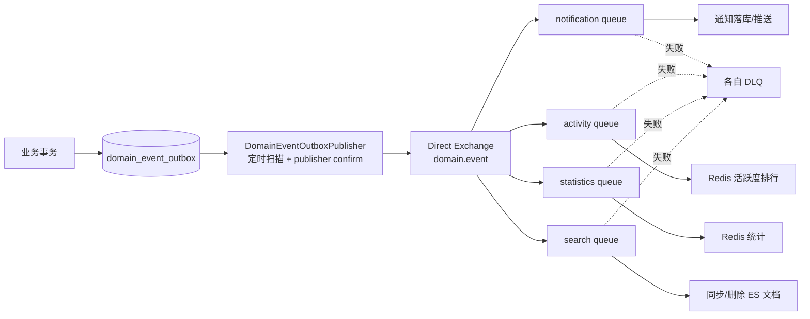

# RabbitMQ 与领域事件

## TL;DR

**已验证**：项目采用“业务事务内写 Outbox → 定时发布 RabbitMQ → 多队列扇出 → 幂等消费”的可靠事件链。通知、活跃度排行、统计和文章搜索各有独立队列；失败消息经本地重试后进入对应死信队列。整套 MQ 仅在 `rabbitmq.switchFlag=true` 时启用。`paicoding-service/src/main/java/com/github/paicoding/forum/service/notify/config/RabbitMqAutoConfig.java:L27-L41` `paicoding-service/src/main/java/com/github/paicoding/forum/service/notify/config/RabbitMqAutoConfig.java:L99-L136`

## 事件总线拓扑

## 生产者：事件如何进入 Outbox

### 文章事件

文章写服务在事务中发布本地 `ArticleMsgEvent`。`ArticleDomainEventOutboxBridge` 通过 `@TransactionalEventListener(BEFORE_COMMIT)` 把它转成统一 `DomainEvent` 并写 Outbox，因此业务数据与事件记录在同一数据库事务中提交。`paicoding-service/src/main/java/com/github/paicoding/forum/service/article/service/impl/ArticleWriteServiceImpl.java:L193-L216` `paicoding-service/src/main/java/com/github/paicoding/forum/service/article/service/ArticleDomainEventOutboxBridge.java:L12-L30`

### 互动事件

评论、点赞/收藏、关注等服务直接在自身事务中调用 `DomainEventOutboxService.append`。例如足迹服务根据操作类型生成 PRAISE/COLLECT 及其取消事件。`paicoding-service/src/main/java/com/github/paicoding/forum/service/user/service/userfoot/UserFootServiceImpl.java:L81-L124` 评论写入也记录 COMMENT/REPLY。`paicoding-service/src/main/java/com/github/paicoding/forum/service/comment/service/impl/CommentWriteServiceImpl.java:L62-L119`

`DomainEventOutboxServiceImpl` 使用 `JdbcTemplate` 插入 `domain_event_outbox`，初始状态为 PENDING。`paicoding-service/src/main/java/com/github/paicoding/forum/service/notify/service/impl/DomainEventOutboxServiceImpl.java:L14-L28`

## 发布器：Outbox → RabbitMQ

`DomainEventOutboxPublisher` 每隔配置的间隔扫描 PENDING/FAILED 记录，先 CAS 式标记为 SENDING，再发布持久消息。它等待 publisher confirm，并检查 returned message；成功标 SENT，失败增加 retry_count 并指数退避，最长延迟 300 秒。`paicoding-service/src/main/java/com/github/paicoding/forum/service/notify/service/impl/DomainEventOutboxPublisher.java:L31-L69`

这解决的是“业务事务已提交但 MQ 发送失败”的双写问题：事件不会因瞬时 MQ 故障直接丢失，而会保留在数据库中重试。

## 交换机、队列与可靠性配置

- 一个 durable direct exchange，统一 routing key `domain.event`，四个业务队列同时绑定，因此同一事件可被四类消费者独立处理。`paicoding-service/src/main/java/com/github/paicoding/forum/service/notify/config/RabbitMqAutoConfig.java:L30-L41` `paicoding-service/src/main/java/com/github/paicoding/forum/service/notify/config/RabbitMqAutoConfig.java:L112-L133`
- RabbitTemplate 开启 correlated confirms 与 publisher returns，消息 JSON 序列化。`paicoding-service/src/main/java/com/github/paicoding/forum/service/notify/config/RabbitMqAutoConfig.java:L43-L76`
- Listener 自动 ack；消费失败最多重试 3 次，指数退避，耗尽后拒绝且不 requeue，由死信路由接管。`paicoding-service/src/main/java/com/github/paicoding/forum/service/notify/config/RabbitMqAutoConfig.java:L144-L174`

## 消费者

| 队列 | 过滤/动作 | 证据 |
|---|---|---|
| notification | 忽略文章类和删除类事件；点赞、收藏、关注、评论等写通知，取消操作删除对应通知，提交后 WebSocket 推送 | `paicoding-service/src/main/java/com/github/paicoding/forum/service/notify/service/impl/NotificationDomainEventConsumer.java:L22-L30` `paicoding-service/src/main/java/com/github/paicoding/forum/service/notify/service/impl/NotificationDomainEventHandler.java:L47-L100` |
| activity | 将评论、收藏、点赞、关注、文章上线映射为活跃度变更 | `paicoding-service/src/main/java/com/github/paicoding/forum/service/rank/service/listener/ActivityDomainEventConsumer.java:L24-L45` |
| statistics | 更新用户/文章 Redis 计数；文章上下线/删除时重新计算文章数 | `paicoding-service/src/main/java/com/github/paicoding/forum/service/statistics/listener/StatisticDomainEventConsumer.java:L25-L56` |
| search | 只处理 `ARTICLE_*`；删除事件删 ES 文档，其余同步最新文章 | `paicoding-service/src/main/java/com/github/paicoding/forum/service/article/service/search/ArticleSearchDomainEventConsumer.java:L22-L29` |

消费者统一经 `DomainEventConsumeService.consume(consumerName, event, action)` 执行业务，用消费记录表实现幂等。通知处理器也通过 `INSERT IGNORE` 获取事件处理权。`paicoding-service/src/main/java/com/github/paicoding/forum/service/notify/service/impl/NotificationDomainEventHandler.java:L47-L54`

## 与本地 Spring Event 的关系

代码仍保留 `SpringUtil.publishEvent` 与 `NotifyMsgEvent`，用于事务内桥接或进程内兼容逻辑；可靠的跨边界副作用走 Outbox/RabbitMQ。不要把两者简单视为重复：

- Spring Event：同进程、低延迟、默认不具备 Broker 持久化；
- Outbox + RabbitMQ：跨进程、可重试、可扇出、可观测，但有最终一致性延迟。

## 关闭 RabbitMQ 时会怎样

**已验证**：MQ 配置、Publisher 和消费者都条件化关闭。业务代码仍可能写 Outbox，因此“主交易可完成，但异步通知/统计/排行/搜索同步不会由这些消费者推进”。这是从条件 Bean 与无条件 `append` 组合得出的静态推论。`paicoding-service/src/main/java/com/github/paicoding/forum/service/notify/service/impl/DomainEventOutboxPublisher.java:L19-L22` `paicoding-service/src/main/java/com/github/paicoding/forum/service/notify/service/impl/DomainEventOutboxServiceImpl.java:L14-L28`

## 运维检查点

- Outbox PENDING/FAILED/SENDING 积压与最老事件年龄；
- 四个业务队列 backlog；
- 四个 DLQ 数量；
- publisher nack/return；
- listener retry/dead-letter；
- 每个 consumer 的去重记录增长。

代码已提供队列 backlog、死信、confirm、消费和推送指标聚合。`paicoding-service/src/main/java/com/github/paicoding/forum/service/notify/monitor/DomainEventMessageMonitor.java:L34-L72`

[上一页：Redis](04-redis.md) · [返回索引](README.md) · [下一页：Elasticsearch](06-elasticsearch.md)

