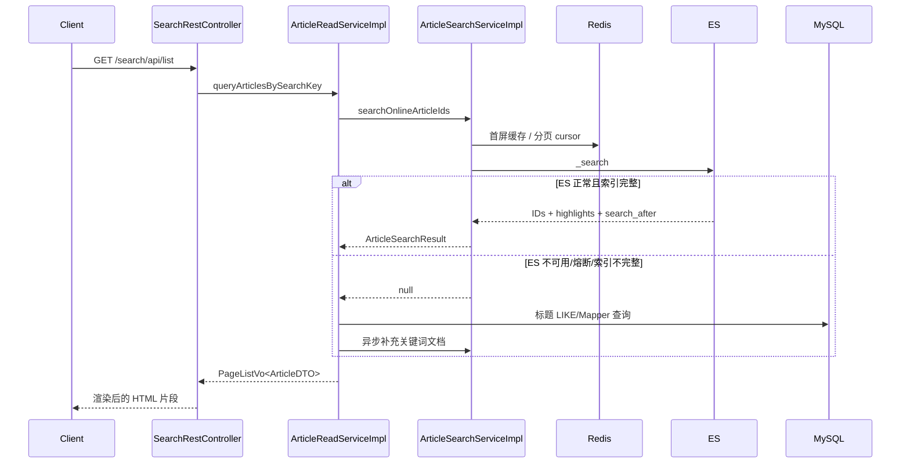

# Elasticsearch 搜索链路

## TL;DR

文章搜索由 `ArticleSearchService` 封装。ES 开启且索引完整时返回文章 ID、highlight 和分页 cursor；未开启、请求失败、熔断或索引覆盖不完整时返回 `null`，上层自动回退 MySQL 标题查询。文章变更通过 RabbitMQ search queue 增量同步；同时支持全量重建和 MySQL/ES 一致性检查。`paicoding-service/src/main/java/com/github/paicoding/forum/service/article/service/search/ArticleSearchService.java:L8-L65` `paicoding-service/src/main/java/com/github/paicoding/forum/service/article/service/impl/ArticleReadServiceImpl.java:L312-L335`

## 查询链路

### Web 入口

`SearchRestController` 提供 hint、list、status、hot、suggestions、zero-result 和 click 记录接口；list 最终调用 `ArticleReadService.queryArticlesBySearchKey`。`paicoding-web/src/main/java/com/github/paicoding/forum/web/front/search/rest/SearchRestController.java:L31-L45` `paicoding-web/src/main/java/com/github/paicoding/forum/web/front/search/rest/SearchRestController.java:L68-L107`

### Service 的 ES 优先与 MySQL 回退

提示词与分页搜索先调用 `ArticleSearchService`。若返回非 null，则按 ID 回表构建展示 DTO；若返回 null，则用 ArticleDao 的 MySQL 查询，并异步调用 `syncHintKeyword`/`syncOnlineKeyword` 补文档。`paicoding-service/src/main/java/com/github/paicoding/forum/service/article/service/impl/ArticleReadServiceImpl.java:L295-L309` `paicoding-service/src/main/java/com/github/paicoding/forum/service/article/service/impl/ArticleReadServiceImpl.java:L312-L335`

### ES 查询内容

在线搜索匹配标题、短标题、摘要和正文，并附加“文章在线”等过滤条件。`paicoding-service/src/main/java/com/github/paicoding/forum/service/article/service/search/impl/ArticleSearchServiceImpl.java:L215-L232` 实现使用 Low Level `RestClient` 请求 `/{alias}/_search`，解析 hits、source、highlight 与 `search_after`。`paicoding-service/src/main/java/com/github/paicoding/forum/service/article/service/search/impl/ArticleSearchServiceImpl.java:L668-L715`

## 客户端配置

`ElasticsearchConfig` 在开关开启时创建 `RestHighLevelClient`，配置 host/scheme、可选认证、连接超时、连接池和 ES 8 API compatibility mode。`paicoding-service/src/main/java/com/github/paicoding/forum/service/config/es/ElasticsearchConfig.java:L32-L74` `paicoding-service/src/main/java/com/github/paicoding/forum/service/config/es/ElasticsearchConfig.java:L80-L130`

代码允许本地自签名证书的 trust-all 开关，并明确注释生产不要启用。`paicoding-service/src/main/java/com/github/paicoding/forum/service/config/es/ElasticsearchConfig.java:L73-L77` 这是需要部署审计的安全配置点。

## 状态、熔断与降级

运行状态分为：

- `ES_NORMAL`：ES 正常服务；
- `INDEX_REBUILDING`：新索引重建中，若旧索引覆盖完整仍可继续服务；
- `MYSQL_TITLE_FALLBACK`：索引覆盖不完整；
- `ES_UNAVAILABLE`：未开启、无 client、失败或熔断。

状态判断与用户可读 message 在实现中明确编码。`paicoding-service/src/main/java/com/github/paicoding/forum/service/article/service/search/impl/ArticleSearchServiceImpl.java:L159-L194`

`search()` 在以下情况返回 null 触发上层回退：ES 未启用、熔断打开、索引不可用、覆盖不完整、请求异常。`paicoding-service/src/main/java/com/github/paicoding/forum/service/article/service/search/impl/ArticleSearchServiceImpl.java:L603-L638`

## Redis 在搜索中的角色

- 第一页查询结果缓存；
- 后续页 `search_after` cursor；
- 查询次数、点击次数、热词、零结果词；
- 搜索文档按关键词 bootstrap 的锁/完成标记；
- 索引 generation 用于缓存失效。

首屏缓存和 cursor 的读写在 `executeSearchPage`。`paicoding-service/src/main/java/com/github/paicoding/forum/service/article/service/search/impl/ArticleSearchServiceImpl.java:L641-L665`

## 索引同步

### 增量

文章事件进入 RabbitMQ search queue。消费者收到 `ARTICLE_DELETE` 时调用 `deleteArticle`，其他 `ARTICLE_*` 调用 `syncArticle`。`paicoding-service/src/main/java/com/github/paicoding/forum/service/article/service/search/ArticleSearchDomainEventConsumer.java:L22-L29`

`syncArticle` 从 MySQL 查询搜索文档；文章不存在、已删除或非 ONLINE 时转为删除，否则写当前 serving index；若同时有重建索引，也双写重建目标。`paicoding-service/src/main/java/com/github/paicoding/forum/service/article/service/search/impl/ArticleSearchServiceImpl.java:L555-L578`

### 全量与一致性

Service API 暴露全量重建、查询任务、失败批次重试、中止和立即一致性检查。`paicoding-service/src/main/java/com/github/paicoding/forum/service/article/service/search/ArticleSearchService.java:L46-L59` Mapper 提供按 ID 游标/范围扫描、计数、最大更新时间和最大 ID 查询，为重建与核验提供 MySQL 基准。`paicoding-service/src/main/java/com/github/paicoding/forum/service/article/repository/mapper/ArticleMapper.java:L77-L94`

## 开发建议

- 业务读取不要直接注入 ES Client，统一走 `ArticleSearchService`，保留降级和指标。
- 新增索引字段时同步修改：MySQL 投影 DTO/SQL、索引 mapping、文档转换、查询字段、重建与一致性逻辑。
- 文章状态语义必须保留：非 ONLINE/已删除文档不能留在公开索引。
- 分页使用 `search_after` 而不是深分页；Controller 已限制最大页码。`paicoding-web/src/main/java/com/github/paicoding/forum/web/front/search/rest/SearchRestController.java:L68-L79`
- 更新索引后要推进 generation/缓存失效，避免旧结果继续命中。

## 待调查

未连接真实 ES，因此索引 alias、mapping、当前覆盖率、分片副本、实际版本、证书与账号权限均未验证。源码默认值和配置能力不代表生产部署状态。

[上一页：RabbitMQ](05-rabbitmq-and-domain-events.md) · [返回索引](README.md) · [下一页：认证](07-authentication.md)

