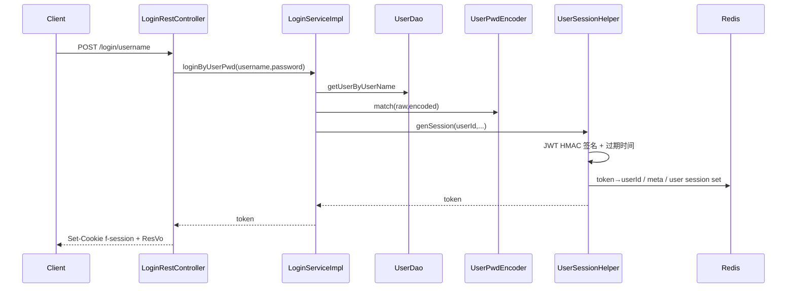
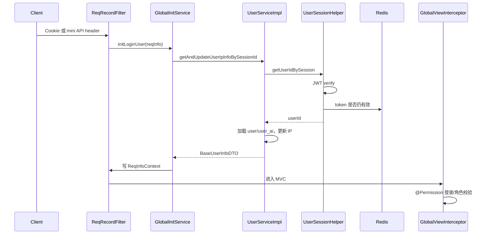

# 登录认证与权限控制

## TL;DR

用户名密码登录先查用户并校验加密密码，再生成带过期时间的 JWT；JWT 同时写入 Redis 作为可撤销有效态，最后放入 `f-session` Cookie。后续请求由 Filter 恢复身份，JWT 验签与 Redis 双检通过后加载用户信息到 `ReqInfoContext`，MVC Interceptor 再执行 `@Permission` 登录/角色授权。`paicoding-web/src/main/java/com/github/paicoding/forum/web/front/login/pwd/LoginRestController.java:L41-L60` `paicoding-service/src/main/java/com/github/paicoding/forum/service/user/service/help/UserSessionHelper.java:L137-L167`

## 用户名密码登录

### 1. Controller

`LoginRestController` 接收用户名/密码，调用 `loginService.loginByUserPwd`，成功后写 `f-session` Cookie；失败返回统一状态。`paicoding-web/src/main/java/com/github/paicoding/forum/web/front/login/pwd/LoginRestController.java:L31-L60` Session key 常量由 `LoginService` 定义。`paicoding-service/src/main/java/com/github/paicoding/forum/service/user/service/LoginService.java:L11-L14`

### 2. 凭据校验

`LoginServiceImpl` 通过 UserDao 查用户；用户不存在或密码不匹配会记录失败审计并抛业务异常。成功后初始化用户 AI 信息、写当前请求 userId，并调用 `UserSessionHelper.genSession`。`paicoding-service/src/main/java/com/github/paicoding/forum/service/user/service/user/LoginServiceImpl.java:L118-L147`

### 3. JWT + Redis 会话

`UserSessionHelper` 从 `paicoding.jwt` 绑定 issuer、secret、expire；构造 HMAC256 Algorithm 与 verifier。本文未读取任何配置值。`paicoding-service/src/main/java/com/github/paicoding/forum/service/user/service/help/UserSessionHelper.java:L68-L84` `paicoding-service/src/main/java/com/github/paicoding/forum/service/user/service/help/UserSessionHelper.java:L103-L127`

生成会话时：

1. JWT payload 放随机 session 标识与 userId，并设置 issuer/expiration；
2. 执行账号禁用与设备数限制；
3. Redis 保存 token→userId 和设备元数据，TTL 与 JWT 对齐；
4. Redis Set 建 user→tokens 索引，支持批量踢下线；
5. 写登录成功审计、活跃 session 和最后登录时间。

证据：`paicoding-service/src/main/java/com/github/paicoding/forum/service/user/service/help/UserSessionHelper.java:L137-L167`。

## 后续请求认证

- 普通 Web 请求从 Cookie 恢复；小程序 `/mini/api/**` 还支持 `Authorization: Bearer`、`f-session` 或 `X-Pai-Token` header。`paicoding-web/src/main/java/com/github/paicoding/forum/web/global/GlobalInitService.java:L113-L160`
- Session 验证先验 JWT，再查 Redis；任一步失败均视为未登录。若账号已禁用，会主动移除 Session。`paicoding-service/src/main/java/com/github/paicoding/forum/service/user/service/help/UserSessionHelper.java:L318-L350`
- UserService 再查 `user_info`/`user_ai`，用户已不存在时删除悬空 Session。`paicoding-service/src/main/java/com/github/paicoding/forum/service/user/service/user/UserServiceImpl.java:L128-L163`
- 成功身份被写入 `ReqInfoContext`，业务层可读取当前 userId/user/session。`paicoding-web/src/main/java/com/github/paicoding/forum/web/global/GlobalInitService.java:L162-L170`

## 授权：`@Permission`

`GlobalViewInterceptor` 从 Controller 方法优先、类其次读取 `@Permission`：

- 无注解或 `ALL`：放行；
- 需要登录但上下文无 userId：REST 返回 `FORBID_NOTLOGIN`，页面重定向；
- 已登录但角色不允许：HTTP 403；
- 允许：进入 Controller。

源码：`paicoding-web/src/main/java/com/github/paicoding/forum/web/hook/interceptor/GlobalViewInterceptor.java:L49-L95`。文章发布就是典型 LOGIN 权限入口。`paicoding-web/src/main/java/com/github/paicoding/forum/web/front/article/rest/ArticleRestController.java:L197-L208`

## 其他登录通道

`LoginService` 还定义微信公众号、知识星球与注册绑定流程。`paicoding-service/src/main/java/com/github/paicoding/forum/service/user/service/LoginService.java:L16-L65` 微信已有用户生成相同的统一 Session；知识星球流程可注册/更新用户后生成 ZSXQ 类型 Session。`paicoding-service/src/main/java/com/github/paicoding/forum/service/user/service/user/LoginServiceImpl.java:L102-L116` `paicoding-service/src/main/java/com/github/paicoding/forum/service/user/service/user/LoginServiceImpl.java:L237-L300`

小程序入口使用 `/mini/api/auth/login`，客户端后续通过统一 request 封装携带 token。`paicoding-miniapp/utils/auth.js:L37-L50` `paicoding-miniapp/utils/request.js:L101-L118`

## 登出、封禁与设备管理

- 登出使 HTTP Session 失效、删除 Redis token/元数据/索引，并清理 Cookie。`paicoding-web/src/main/java/com/github/paicoding/forum/web/front/login/pwd/LoginRestController.java:L82-L96` `paicoding-service/src/main/java/com/github/paicoding/forum/service/user/service/help/UserSessionHelper.java:L188-L216`
- 用户 Session Set 支持按 userId 移除所有 token，用于账号禁用或审核状态变化。
- 设备限制枚举每个用户的活跃 Session 元数据，清理陈旧记录并执行设备策略。`paicoding-service/src/main/java/com/github/paicoding/forum/service/user/service/help/UserSessionHelper.java:L353-L380`

## 安全注意事项

- JWT secret、数据库密码、Redis 密码和第三方凭据只应来自安全配置；禁止写进 Wiki、日志和前端包。
- 验证失败日志当前可能引用 session 变量；部署时应确认日志脱敏策略，避免完整 bearer token 泄漏。`paicoding-service/src/main/java/com/github/paicoding/forum/service/user/service/help/UserSessionHelper.java:L341-L349`
- `@Permission` 是 MVC 授权核心；新增敏感 Controller 时必须显式选择角色，并为类级/方法级覆盖写测试。
- 认证与业务对象授权是两层：例如删除文章除 LOGIN 外还校验文章是否属于当前用户。`paicoding-service/src/main/java/com/github/paicoding/forum/service/article/service/impl/ArticleWriteServiceImpl.java:L263-L278`
- 小程序 header token 只在 `/mini/api/**` 接受，避免无意扩大 bearer token 的入口面。`paicoding-web/src/main/java/com/github/paicoding/forum/web/global/GlobalInitService.java:L139-L160`

[上一页：Elasticsearch](06-elasticsearch.md) · [返回索引](README.md) · [下一页：核心业务](08-core-business-flows.md)

