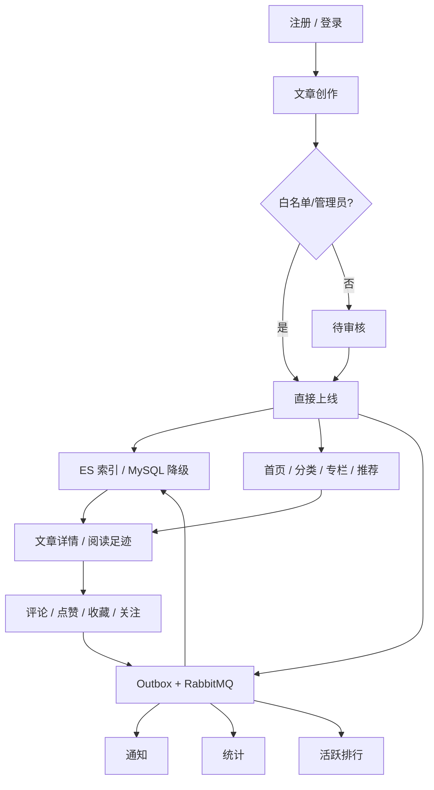

# 核心业务流程

## TL;DR

核心业务围绕“内容生产 → 审核/上线 → 搜索与分发 → 阅读互动 → 通知/统计/排行”闭环。MySQL 保存权威业务数据，Redis 承载会话与高频状态，RabbitMQ 扇出最终一致的副作用，Elasticsearch 提供全文检索，Thymeleaf 与小程序是两个主要客户端形态。

## 业务全景

## 1. 文章发布、审核与上线

**入口**：`POST /article/api/post`，要求登录。Controller 把请求与当前 userId 传给 `ArticleWriteService.saveArticle`。`paicoding-web/src/main/java/com/github/paicoding/forum/web/front/article/rest/ArticleRestController.java:L197-L221`

**核心规则**：

1. DTO 转 ArticleDO，生成/校验唯一 slug，替换 Markdown 图片引用；
2. 非可绕过审核的作者执行敏感内容检查；
3. 新文章若需要审核，状态设 REVIEW；
4. 事务内写 article、article_detail、article_tag、作者阅读足迹；
5. 发布 CREATE 与 ONLINE/REVIEW 事件；
6. 若关联专栏，再写 column-article 关系。

证据：`paicoding-service/src/main/java/com/github/paicoding/forum/service/article/service/impl/ArticleWriteServiceImpl.java:L91-L117` `paicoding-service/src/main/java/com/github/paicoding/forum/service/article/service/impl/ArticleWriteServiceImpl.java:L186-L217`。

**后续副作用**：文章事件在事务提交前写 Outbox，MQ 消费后更新 ES、用户文章数与活跃度。`paicoding-service/src/main/java/com/github/paicoding/forum/service/article/service/ArticleDomainEventOutboxBridge.java:L21-L30` `paicoding-service/src/main/java/com/github/paicoding/forum/service/article/service/search/ArticleSearchDomainEventConsumer.java:L22-L29`

## 2. 内容发现、搜索与阅读

内容入口包括首页文章流、分类、标签、专栏、推荐、用户文章和搜索。Web 的文章详情先由 `ArticleReadService.queryFullArticleInfo` 获取完整 DTO，再将 Markdown 转 HTML，并补作者信息。`paicoding-web/src/main/java/com/github/paicoding/forum/web/front/article/rest/ArticleRestController.java:L79-L100`

搜索优先 ES，异常或覆盖不全时回退 MySQL；结果 ID 再回表构建完整 DTO，避免把 ES 当业务事实源。`paicoding-service/src/main/java/com/github/paicoding/forum/service/article/service/impl/ArticleReadServiceImpl.java:L312-L335`

小程序对应 `/mini/api/articles`、`/mini/api/categories`、`/mini/api/search` 与文章详情端点。`paicoding-miniapp/pages/index/index.js:L46-L71` `paicoding-miniapp/pages/search/search.js:L102-L103` `paicoding-miniapp/pages/detail/detail.js:L121-L144`

## 3. 评论与回复

**入口**：`POST /comment/api/post`，Controller 要求登录并调用 CommentWriteService。`paicoding-web/src/main/java/com/github/paicoding/forum/web/front/comment/rest/CommentRestController.java:L101-L113`

**Service 流程**：

1. 敏感词检查；
2. 新增顶级评论或回复；
3. 校验文章/父评论并保存评论足迹；
4. 可选触发 AI bot 回复；
5. Outbox 写 COMMENT/REPLY；
6. 保留本地 `NotifyMsgEvent` 供进程内兼容逻辑。

证据：`paicoding-service/src/main/java/com/github/paicoding/forum/service/comment/service/impl/CommentWriteServiceImpl.java:L61-L119`。

删除评论会做存在性/越权校验、更新足迹、记录 DELETE_COMMENT Outbox，并发布删除事件。`paicoding-service/src/main/java/com/github/paicoding/forum/service/comment/service/impl/CommentWriteServiceImpl.java:L134-L168`

## 4. 点赞、收藏与足迹

文章互动入口先确认文章存在，再调用 `UserFootService.favorArticleComment`。`paicoding-web/src/main/java/com/github/paicoding/forum/web/front/article/rest/ArticleRestController.java:L166-L193`

UserFoot 是点赞、收藏、阅读、评论状态的统一关系记录：按 documentType + documentId + userId 查询，存在则更新，不存在则插入；随后将操作映射为 PRAISE/COLLECT/取消事件写 Outbox，并发布本地通知事件。`paicoding-service/src/main/java/com/github/paicoding/forum/service/user/service/userfoot/UserFootServiceImpl.java:L49-L67` `paicoding-service/src/main/java/com/github/paicoding/forum/service/user/service/userfoot/UserFootServiceImpl.java:L81-L124`

这条事件会同时驱动：

- 通知落库/撤销与 WebSocket 推送；
- 文章和作者 Redis 计数；
- 用户活跃度排行。

## 5. 关注关系

`POST /user/api/saveUserRelation` 要求登录，Controller 调用 UserRelationService。`paicoding-web/src/main/java/com/github/paicoding/forum/web/front/user/rest/UserRestController.java:L32-L60` Service 保存关注/取消关注关系后记录 FOLLOW/CANCEL_FOLLOW Outbox，并发布通知事件。`paicoding-service/src/main/java/com/github/paicoding/forum/service/user/service/relation/UserRelationServiceImpl.java:L128-L141`

后续消费者更新被关注者粉丝数、操作者关注数、通知和活跃度。`paicoding-service/src/main/java/com/github/paicoding/forum/service/statistics/listener/StatisticDomainEventConsumer.java:L34-L46` `paicoding-service/src/main/java/com/github/paicoding/forum/service/rank/service/listener/ActivityDomainEventConsumer.java:L33-L44`

## 6. 通知

Notification Consumer 接收互动事件，并用消费表抢占 eventId，保证同一消费者幂等。它构造 `NotifyMsgDO`，写未读通知；事务提交后再通过 NotifyService 向用户推送。取消点赞/收藏/关注则按业务键移除旧通知。`paicoding-service/src/main/java/com/github/paicoding/forum/service/notify/service/impl/NotificationDomainEventHandler.java:L47-L100` `paicoding-service/src/main/java/com/github/paicoding/forum/service/notify/service/impl/NotificationDomainEventHandler.java:L104-L121`

Web 请求恢复登录态时会查询未读消息数并放入全局上下文；页面全局 VO 展示该数量。`paicoding-web/src/main/java/com/github/paicoding/forum/web/global/GlobalInitService.java:L162-L170` `paicoding-web/src/main/java/com/github/paicoding/forum/web/global/GlobalInitService.java:L81-L88`

## 7. 统计与排行榜

统计数据采用 Redis Hash 高频累加，MQ statistics consumer 处理评论、点赞、收藏、关注和文章状态事件。`paicoding-service/src/main/java/com/github/paicoding/forum/service/statistics/listener/StatisticDomainEventConsumer.java:L25-L56`

活动排行把不同事件映射为 `ActivityScoreBo`，交给 `UserActivityRankService`；后者使用 Redis Lua 与 Sorted Set 原子更新日/月榜，并有定时汇总与恢复逻辑。`paicoding-service/src/main/java/com/github/paicoding/forum/service/rank/service/listener/ActivityDomainEventConsumer.java:L24-L45` `paicoding-service/src/main/java/com/github/paicoding/forum/service/rank/service/impl/UserActivityRankServiceImpl.java:L208-L268`

匿名/普通页面访问也可能由 MVC 拦截器记活跃行为。`paicoding-web/src/main/java/com/github/paicoding/forum/web/hook/interceptor/GlobalViewInterceptor.java:L56-L69`

## 8. AI 聊天

WebSocket STOMP 的 `/chat/{session}` 与 `/chat/{session}/{chatId}` 接收消息，恢复 WebSocket 请求上下文后交给 `WsAnswerHelper`；REST 接口用于列出会话、同步历史和重命名/删除会话。`paicoding-web/src/main/java/com/github/paicoding/forum/web/front/chat/rest/ChatRestController.java:L57-L90` `paicoding-web/src/main/java/com/github/paicoding/forum/web/front/chat/rest/ChatRestController.java:L119-L166`

聊天历史主要保存在 Redis：Hash 是会话目录，List 是消息项；消息列表会裁剪以限制长度。`paicoding-service/src/main/java/com/github/paicoding/forum/service/chatai/service/history/ChatHistoryServiceImpl.java:L48-L107` 不同模型供应商由 service/chatai 下的集成实现路由，调用额度由 Redis 每日计数保护。`paicoding-service/src/main/java/com/github/paicoding/forum/service/chatai/service/AbsChatService.java:L66-L86`

## 9. 文章付费

`ArticlePayRestController` 提供发起支付、更新支付状态和回调入口，登录用户通过 ArticlePayService 进入支付集成。`paicoding-web/src/main/java/com/github/paicoding/forum/web/front/article/rest/ArticlePayRestController.java:L30-L80` Service 模块包含 `pay/service/integration/wx` 与 email 集成；这是外部资金/回调边界，修改时必须额外审计签名、幂等、金额与状态机。

## 关键一致性模型

| 数据 | 权威源 | 派生/加速层 | 一致性 |
|---|---|---|---|
| 用户、文章、正文、评论、关系、足迹 | MySQL | Redis 计数/缓存、ES 文档 | 主事务强一致；派生层最终一致 |
| 事件 | MySQL Outbox | RabbitMQ 队列 | 至少一次发布/消费，靠幂等去重 |
| 会话 | JWT + Redis 有效态 | Cookie/header 传输 | 请求时双检 |
| 搜索 | MySQL 文章状态 | Elasticsearch + Redis 查询缓存 | 增量同步，可回退 MySQL |
| 排行/统计 | 业务事件/部分 MySQL 重算 | Redis | 最终一致，Lua 保证局部原子性 |

[上一页：认证](07-authentication.md) · [返回索引](README.md) · [下一页：开发地图](09-development-map-and-risks.md)

